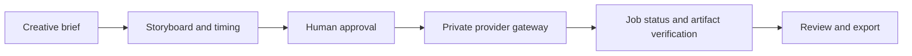

# Conceptual architecture

This is a proposed public-facing architectural model, not a verified production topology.

A reliable media pipeline should distinguish planned scenes, submitted jobs, completed artifacts and verified playable output. Provider credentials, model routing, wallet logic, prompts and internal infrastructure are excluded. No claim is made that all stages are operational in the original product.
